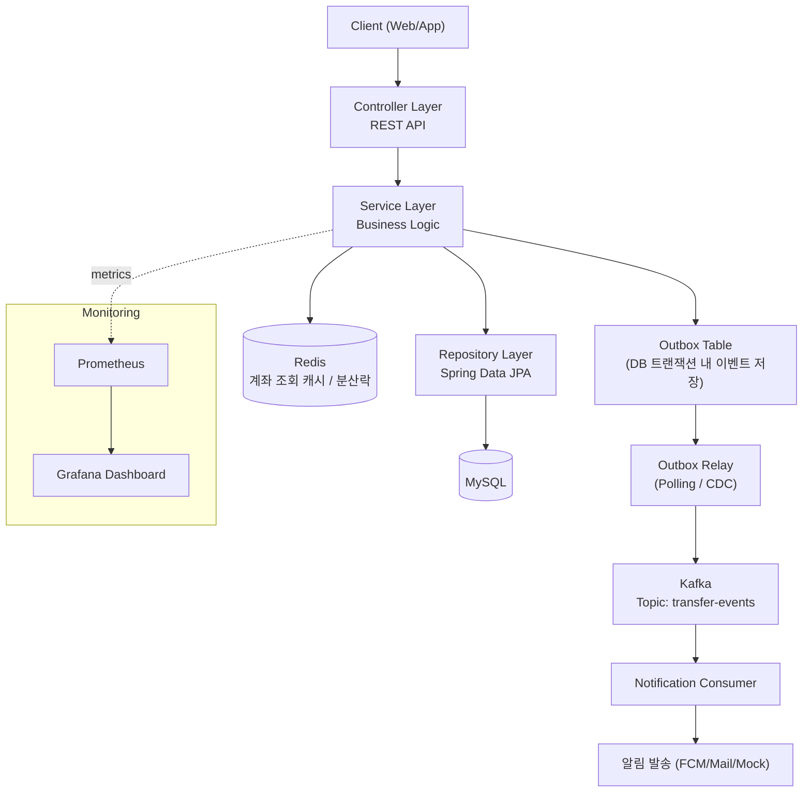

# banking-transfer-system
> 인터넷 뱅킹 송금 서비스를 설계하고 구현하는 백엔드 프로젝트

# Project Overview
> 실제 인터넷 뱅킹의 송금 프로세스를 기반으로 금융 도메인을 학습하고, 단순 CRUD를 넘어 데이터 정합성, 동시성 제어, 이벤트 기반 처리를 고려한 백엔드 시스템을 구현하는 것을 목표로 합니다.

# Goals
- 송금 시스템 구현
- 데이터 정합성 보장
- 동시성 문제 해결
- 이벤트 기반 아키텍처 적용
- 운영 환경 및 성능 테스트 경험

---

# Features

## Member
- 회원가입
- 로그인
- 회원 정보 조회

## Account
- 계좌 개설
- 계좌 조회
- 계좌 목록 조회
- 계좌 잠금 / 해제

## Banking
- 입급
- 출금
- 계좌 간 송금
- 송금 한도 검증
- 잔액 검증

## Transaction
- 거래내역 조회
- 거래 상세 조회
- 거래 유형별 조회

## Notification
- 송금 완료 알림
- 입금 완료 알림

---

# Tech Stack

| Category | Stack |
|-----------|-------|
| Language | Java 21 |
| Framework | Spring Boot |
| Database | MySQL |
| Cache | Redis |
| Message Broker | Kafka |
| ORM | Spring Data JPA |
| Build Tool | Gradle |
| Infra | Docker |

---

# Architecture

## 전체 구조

 
